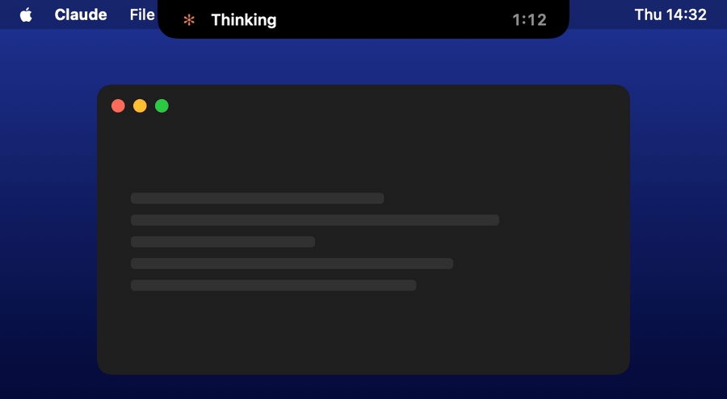
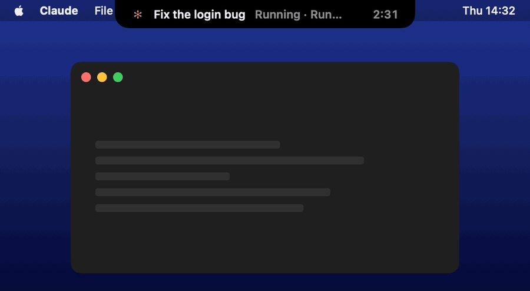
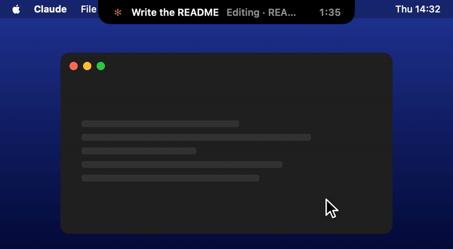
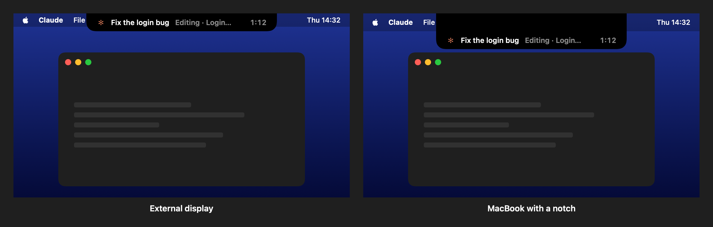

<p align="center">
  
</p>

<h1 align="center">Ada</h1>

<p align="center">
  <b>A small black island at the top of your Mac's screen that shows what Claude Code is doing.</b><br>
  Glance up to see the current step and how long the turn has been running. When Claude finishes, Ada chimes and your screen glows.
</p>

<p align="center">
  
</p>

---

When Claude Code works on something long, you switch to another window, another display or another task. Then you keep coming back to check whether it is done. Ada saves you the trip:

1. **See the current step from anywhere.** A black island sits at the top center of the screen, under the notch on a MacBook or over the menu bar on an external display. It shows the chat's name, the current step (*Reading*, *Editing · LoginView.swift*, *Running · Build the app*) and a timer for the turn.
2. **Know the moment it is done.** When the turn ends, the island turns green, a soft two-note chime plays and, after a long turn, every display glows three times.
3. **Keep track of several chats.** Hover over the island to see your other Claude chats. Click one to open it in the Claude app.

Ada is driven by [Claude Code hooks](https://docs.claude.com/en/docs/claude-code/hooks), so it works the same with the Claude desktop app and the `claude` command in the terminal. It runs in the background, has no Dock icon and sends nothing anywhere.

*Ada* means *island* in Turkish. The labels follow your system language: Turkish on a Turkish Mac, English everywhere else.

## Contents

- [What the island shows](#what-the-island-shows)
- [When Claude finishes](#when-claude-finishes)
- [Hover and click](#hover-and-click)
- [External displays and the notch](#external-displays-and-the-notch)
- [Installation](#installation)
- [How it works](#how-it-works)
- [Building and contributing](#building-and-contributing)

## What the island shows

On the left, Claude's spinning asterisk, the chat's name as it appears in the Claude app and, in grey, the current step. On the right, the time since you sent your message.

| Claude is… | The step reads |
|---|---|
| between tools, thinking | **Thinking** |
| reading a file | **Reading** · file name |
| editing or writing a file | **Editing** · file name |
| running a shell command | **Running** · the command's description |
| searching the code | **Searching** |
| fetching a page or searching the web | **Browsing the web** |
| running a subagent | **Running an agent** · its task |
| asking you a question | **Asking you** |
| waiting for you to approve a tool | **Waiting for your approval** |

If several chats are working at once, the island follows the one that moved last.

## When Claude finishes

<p align="center">
  
</p>

When the turn ends, the island shows a green check, **Done** and the name of the chat. It also plays a short two-note chime that is generated in code, so there is no sound file.

If the turn took longer than 20 seconds, every connected display also glows white three times. It is the same pulse the [Houra](https://github.com/serbestonline/Houra) focus timer uses when a break is due. Quick answers only chime, so a short back-and-forth does not flash your screen.

The island then stays on **Done** with the length of the last turn until Claude starts working again.

## Hover and click

<p align="center">
  
</p>

Move the mouse onto the island and it slides open with your other chats from the last 12 hours. Working chats come first, then finished ones, newest at the top. Each row shows the chat's name as it appears in the Claude app, what it is doing and its timer. Move the mouse away and the island closes again.

**Click a row** and that chat opens in the Claude desktop app. Click the top line to open the chat the island is showing. Chats started from the terminal have no window in the app, so clicking them just brings Claude to the front.

## External displays and the notch

<p align="center">
  
</p>

The island follows your mouse to whichever display it is on. On an external display it sits over the middle of the menu bar. On a MacBook with a notch it grows down from the notch, so the text sits just below it. It stays visible on every Space and over full-screen apps.

## Installation

Requirements: macOS 14 or later on Apple Silicon, the Xcode Command Line Tools and [Claude Code](https://docs.claude.com/en/docs/claude-code/overview). There is no Xcode project and no third-party dependency.

### 1. Build and install the app

```bash
xcode-select --install          # if the Command Line Tools are not installed yet

git clone https://github.com/serbestonline/Ada.git
cd Ada
./build.sh --install            # builds, installs to /Applications and starts Ada
```

| Command | Result |
|---|---|
| `./build.sh` | Builds `build/Ada.app` |
| `./build.sh --install` | Also installs it to `/Applications` and restarts it |

### 2. Connect it to Claude Code

Add Ada to the `hooks` section of `~/.claude/settings.json`. Every event runs the same command:

```json
{
  "hooks": {
    "UserPromptSubmit": [{ "hooks": [{ "type": "command", "command": "/Applications/Ada.app/Contents/MacOS/Ada hook", "timeout": 5 }] }],
    "PreToolUse":       [{ "matcher": "*", "hooks": [{ "type": "command", "command": "/Applications/Ada.app/Contents/MacOS/Ada hook", "timeout": 5 }] }],
    "PostToolUse":      [{ "matcher": "*", "hooks": [{ "type": "command", "command": "/Applications/Ada.app/Contents/MacOS/Ada hook", "timeout": 5 }] }],
    "Notification":     [{ "matcher": "permission_prompt", "hooks": [{ "type": "command", "command": "/Applications/Ada.app/Contents/MacOS/Ada hook", "timeout": 5 }] }],
    "Stop":             [{ "hooks": [{ "type": "command", "command": "/Applications/Ada.app/Contents/MacOS/Ada hook", "timeout": 5 }] }],
    "SessionEnd":       [{ "hooks": [{ "type": "command", "command": "/Applications/Ada.app/Contents/MacOS/Ada hook", "timeout": 5 }] }]
  }
}
```

If you already have hooks for some of these events, add Ada's entry next to them in the same list. Running sessions pick up the change on their next step.

You do not need to start Ada yourself or add it to your login items: if it is not running, the first hook starts it.

## How it works

- **One binary, two roles.** Claude Code runs `Ada hook` for every event and passes the event as JSON. That short-lived process turns it into a label (for example *Editing · main.swift*), sends it to the running island and exits. Without arguments, the same binary is the island itself.
- **Chat names and links.** For chats in the Claude desktop app, Ada reads the chat's title and id from the app's session records in `~/Library/Application Support/Claude/claude-code-sessions`, and opens a chat through the app's `claude://code/continue?session=…` link. Both are internal details of the Claude app, not a documented API, so a future app update may change them. If that happens, rows fall back to the folder name and clicking just brings Claude to the front.
- **Interrupted turns.** If you stop a turn with Esc, Claude Code sends no *Stop* event. After 10 minutes without any event, the island goes back to the last finished chat.
- **Privacy.** Everything stays on your Mac. Ada keeps its state in memory only and writes no files.

## Building and contributing

The app is plain Swift (AppKit + SwiftUI) in `Sources/`:

| File | What it does |
|---|---|
| `main.swift` | Hook mode, the island's state and view, the window, the screen pulse and the chime |
| `Media.swift` | Draws the README's GIFs and images on a mock desktop |

| Command | What it does |
|---|---|
| `Ada selftest` | Checks the hook labels |
| `Ada snapshot <file.png>` | Draws the island's states into one image |
| `Ada title <session-id>` | Prints the Claude app's title and id for a Claude Code session |

The GIFs and images in this README are produced by the app itself: `./scripts/make_media.sh` builds the app, draws each scenario frame by frame on a mock desktop and turns the frames into GIFs with [ffmpeg](https://ffmpeg.org). No screen recording is involved.

## Credits

- The screen pulse and the chime come from [Houra](https://github.com/serbestonline/Houra).
- Made by [Serbest](https://github.com/serbestonline).

## License

MIT
